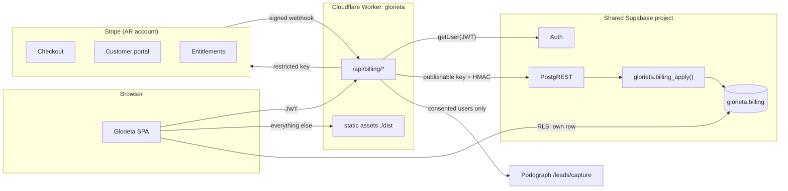
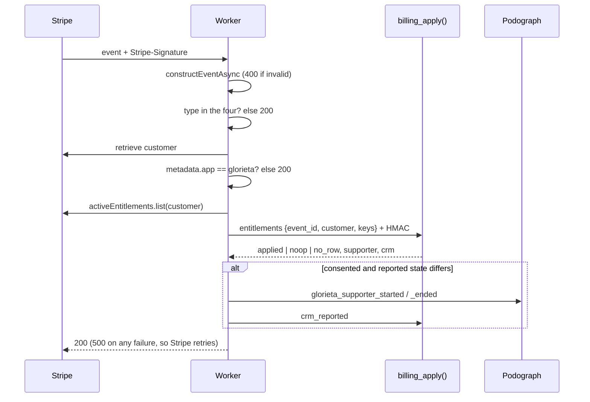

# Design Document: stripe-support-plan

## Overview

Glorieta gains an optional recurring support plan on the Applied Relevance Stripe account. Stripe
owns the catalog, checkout, card handling, receipts and the subscription itself. Glorieta keeps a
one-way mirror of the user's active Stripe Entitlements, written only after a verified webhook.
Nothing in the study experience reads the mirror except the supporter badge.

Three pieces change:

1. **The Glorieta Worker gains a script.** It serves `/api/billing/*` and leaves every other path to
   the static assets exactly as today.
2. **The `glorieta` schema gains a billing mirror** and one `security definer` function that is the
   only way to write it. The Worker calls that function through PostgREST with the public
   publishable key and an HMAC signature. No service-role key, Postgres role or Edge Function is
   involved, so nothing outside the `glorieta` schema is created or changed.
3. **The SPA gains a support page**, a profile badge, a thank-you state and a billing step in
   "Delete my Glorieta data", in ES and EN.

The logic is ported from LinguaMama (`appliedrelevance/linguamama`, `supabase/functions/`), with
three deliberate differences: identity is the `auth.users` id held in the mirror rather than an
email match, the storage target is `glorieta.billing`, and Glorieta never looks up a Stripe
customer by email.

## Architecture



### Routing

`wrangler.jsonc` adds a script and runs it first only for the API:

```jsonc
{
  "main": "worker/index.ts",
  "compatibility_flags": ["nodejs_compat"],
  "assets": {
    "directory": "./dist",
    "binding": "ASSETS",
    "not_found_handling": "single-page-application",
    "run_worker_first": ["/api/*"]
  },
  "vars": {
    "SITE_ORIGIN": "https://glorieta.anaidic.com",
    "SUPABASE_URL": "https://qgfmwstgkwyqqwyqroav.supabase.co",
    "SUPABASE_PUBLISHABLE_KEY": "sb_publishable_qGi7AfmrPvli1JOZWNwFzQ_eO5_rj9D",
    "PODOGRAPH_BRAND_ID": "glorieta"
  }
}
```

`STRIPE_PORTAL_CONFIGURATION` joins `vars` once the catalog script has created the portal
configuration; it is an id, not a secret, and differs between test and live mode.

Every request outside `/api/*` reaches the assets without invoking the script, so the static app
stays as fast and as cheap as today. A request under `/api/*` that matches no route returns 404
from the script.

### Secrets

| Secret | Where it lives | Used for |
|---|---|---|
| `STRIPE_RESTRICTED_KEY` (`rk_test_…`, later `rk_live_…`) | 1Password + `wrangler secret` | All Stripe API calls |
| `STRIPE_WEBHOOK_SECRET` (`whsec_…`) | 1Password + `wrangler secret` | Verifying webhook signatures |
| `BILLING_HMAC_KEY` (64 random hex chars) | 1Password + `wrangler secret` + `glorieta.billing_key` | Signing calls to `glorieta.billing_apply()` |

Local development keeps test-mode values in `.dev.vars`, which is already in `.gitignore`.

### Restricted key permissions

| Resource | Access |
|---|---|
| Checkout Sessions | Write |
| Customers | Write (create, retrieve, delete) |
| Subscriptions | Write (cancel at period end, switch Price, default card) |
| Products, Prices | Read |
| Invoices, SetupIntents | Read |
| Entitlements (active entitlements) | Read |
| Everything else | None |

### Why an HMAC-signed function and not a credential

Requirement 6.3 forbids a webhook credential that reaches beyond `glorieta`. On the shared project
the service-role key and `sb_secret_…` keys reach every schema, including Podograph's CRM. A
dedicated Postgres login role would satisfy 6.3, but creating it is project-level work owned by the
monorepo and needs Hyperdrive for the Worker to connect.

The signed function satisfies 6.3 inside the schema Glorieta owns. The Worker calls it as `anon`
with the publishable key, which already ships in the browser. The function refuses any call whose
body is not signed with `BILLING_HMAC_KEY`. That key can do exactly what `billing_apply()` does
(link a customer, set `glorieta_*` keys, clear them, record the CRM state) and nothing else. If it
leaks, the worst outcome is a forged supporter badge, which grants no study feature because there
are none to grant.

## Components and Interfaces

### Worker modules (`worker/`)

| File | Responsibility |
|---|---|
| `index.ts` | Router for `/api/billing/*`; method checks; JSON errors; nothing else |
| `stripe.ts` | The only `new Stripe()` in the repo. API version pinned to `Stripe.API_VERSION`, the version the installed SDK is typed against (`2026-08-26.dahlia` for 22.6.2, the same dahlia line as LinguaMama's `2026-03-25.dahlia`); refuses any key that is not `rk_`. `Stripe.createFetchHttpClient()`, `Stripe.createSubtleCryptoProvider()` |
| `auth.ts` | Reads `Authorization: Bearer <jwt>`, resolves the user with `supabase.auth.getUser(jwt)`; 401 on anything else |
| `mirror.ts` | Signs and sends `billing_apply()` calls; reads the caller's own row with the caller's JWT |
| `entitlements.ts` | Pure: filter keys to `glorieta_*`, decide supporter state, decide whether Podograph needs a signal |
| `crm.ts` | Posts supporter events to `https://api.podograph.com/leads/capture` |
| `catalog.ts` | Maps `month` / `year` to the Price lookup keys `glorieta_supporter_monthly` / `glorieta_supporter_annual` |

The Stripe SDK is the npm `stripe` package at the major version LinguaMama uses (22), bundled by
Wrangler.

### HTTP endpoints

All responses are JSON. Errors are `{ "error": { "code": "...", "message": "..." } }` with a real
status code. No endpoint returns default or fallback data.

#### `GET /api/billing/prices` (public)

Reads the two Prices from Stripe by lookup key, with `expand: ['data.product']`, and checks that
both carry metadata `app=glorieta`. Returns:

```ts
type PricesResponse = {
  plans: Array<{
    interval: 'month' | 'year';
    amount: number;   // Price.unit_amount, in cents
    currency: 'eur';
    name: string;     // Product.name
  }>;
};
```

The response carries `Cache-Control: public, max-age=300`. If either Price is missing or inactive
the endpoint returns 503 `catalog_incomplete`, and the support page shows the error instead of
plans. (Req 1.5)

#### `POST /api/billing/checkout` (signed in)

Body: `{ "interval": "month" | "year", "locale": "es" | "en" }`. The client never sends a Price
id, so it cannot point Checkout at a LinguaMama Price.

1. Resolve the user (401 if none). (Req 2.5)
2. Read the caller's `glorieta.billing` row with their JWT. If it holds `glorieta_supporter`,
   return 409 `already_supporter`. (Req 2.6)
3. If the row has a customer id, use it. (Req 2.3) Otherwise create a customer with the user's
   email and metadata `app=glorieta`, `glorieta_user_id=<id>`, then call `billing_apply` with
   `link_customer`. If that call returns a different, already stored customer id (two tabs raced),
   delete the customer just created and use the stored one. If it returns `no_profile`, return
   409 `no_profile`; the SPA creates the profile on sign-in, so this means the sync has not run.
   (Req 2.2)
4. Create the Checkout Session:

   ```ts
   stripe.checkout.sessions.create({
     mode: 'subscription',
     customer,
     client_reference_id: user.id,
     line_items: [{ price: priceIdFor(interval), quantity: 1 }],
     subscription_data: { metadata: { app: 'glorieta', glorieta_user_id: user.id } },
     automatic_tax: { enabled: true },
     customer_update: { address: 'auto', name: 'auto' },
     billing_address_collection: 'required',
     allow_promotion_codes: true,
     locale,
     success_url: `${SITE_ORIGIN}/?checkout=success#/support`,
     cancel_url: `${SITE_ORIGIN}/?checkout=cancel#/support`,
   })
   ```

   The query string sits before the hash because the SPA routes on the hash; the SPA reads
   `checkout` once and removes it from the address bar. (Req 2.1, 2.4, 2.7)
5. Return `{ "url": session.url }`.

#### Managing the plan (signed in), `worker/manage.ts`

The hosted portal was dropped (Req 3, revised): it can only show the shared account's branding. Every
endpoint reads the caller's row (404 `no_customer` without one) and picks the newest subscription with
`metadata.app=glorieta` in `active`, `trialing`, `past_due` or `unpaid` (404 `no_plan` without one).

| Endpoint | Does |
|---|---|
| `GET /api/billing/plan` | `{ plan, invoices }`: interval, amount, status, `period_end` (from the subscription item), `cancel_at_period_end`, the card; the last 12 non-draft invoices with their hosted and PDF links |
| `POST /api/billing/cancel {cancel}` | `cancel_at_period_end` true or false |
| `POST /api/billing/switch {interval}` | the item moves to the other Price by lookup key, `always_invoice` (the difference is charged or credited at once); also clears a pending cancellation; 409 `same_plan` |
| `POST /api/billing/card {locale}` | a Checkout Session in `setup` mode, Glorieta branding, `setup_intent_data.metadata` = `app`, `glorieta_user_id`, `subscription_id`; returns to `?card=saved#/support` |

The webhook's `checkout.session.completed` handles a `setup` session: if the SetupIntent succeeded, is
tagged `app=glorieta`, and names a Glorieta subscription of the same customer, its payment method
becomes the customer's `invoice_settings.default_payment_method` and the subscription's
`default_payment_method`.

#### `POST /api/billing/coffee` (signed in)

A one-time payment ("Invítame a un café / Buy me a coffee"), added 2026-11-15. `amount` is cents, whole
euros from 200 to 20000 (presets 300, 500, 1000, reported by `GET prices`); 400 `bad_amount` otherwise.
Checkout in `payment` mode on the caller's Glorieta customer (created and linked as for a plan), one line
with `price_data` on Product `glorieta_coffee`, `invoice_creation` on, automatic tax, Glorieta branding.
No Stripe entitlement. When `checkout.session.completed` arrives paid with `metadata.kind = coffee`, the
webhook calls `billing_apply` op `coffee` (customer, session id, `amount_subtotal`, currency), which inserts
one `glorieta.coffees` row keyed by the session id (schema 004). Any coffee row shows the Café badge; Mecenas
takes its place while a plan is active.

#### `POST /api/billing/erase` (signed in)

Runs before `glorieta.delete_my_data()`. If the caller has no row, it returns
`{ "erased": false }`. Otherwise:

1. `stripe.customers.del(customer)`. Stripe cancels the customer's subscriptions immediately.
   If Stripe fails, return 502 `stripe_delete_failed` and stop. (Req 8.1, 8.2)
2. `billing_apply` with `clear`, which empties the row's entitlements so that
   `delete_my_data()` will accept the erasure.
3. Return `{ "erased": true }`.

A customer that is already deleted in Stripe (`resource_missing`) counts as success, so a retry
after a half-finished erasure completes.

#### `POST /api/billing/webhook` (Stripe)



| Event | Action |
|---|---|
| `checkout.session.completed` | `link_customer` for `client_reference_id`; no entitlement write (Req 4.3) |
| `customer.subscription.updated` | Sync entitlements for `subscription.customer` (Req 4.2) |
| `customer.subscription.deleted` | Same |
| `entitlements.active_entitlement_summary.updated` | Same, for `summary.customer` |
| anything else | 200, no change (Req 5.3) |

**Isolation (Req 5.2).** The handler retrieves the customer and proceeds only when
`metadata.app === 'glorieta'`. A deleted customer has no metadata; the handler then writes an empty
entitlement set, and `billing_apply` touches only a row that already holds that customer id. Since
such a row exists only for a customer Glorieta created, the database is a second isolation guard:
a LinguaMama customer can never match a row.

**Entitlements.** The handler lists the customer's active entitlements from Stripe (never from the
event payload, so event order does not matter), keeps lookup keys starting with `glorieta_`
(Req 4.5), and sends them with the event id.

**Podograph (Req 8.4, 8.5).** `billing_apply` returns the user's `marketing_opt_in`,
`crm_synced_at` and the last supporter state reported to Podograph. The handler sends a signal only
when consent is on, the lead already exists in Podograph (`crm_synced_at` is set), and the current
state differs from the last one reported:

```json
{
  "email": "<customer.email>",
  "brand_id": "glorieta",
  "source_url": "https://glorieta.anaidic.com",
  "event_type": "glorieta_supporter_started",
  "payload": { "app": "glorieta", "supporter": true }
}
```

After Podograph answers 2xx with `success: true`, the handler records the new state with
`crm_reported`. A Podograph failure returns 500, Stripe retries, the retry is an entitlement no-op,
and the signal is attempted again because the reported state still differs. The request carries no
`Origin` header, which Podograph's allowlist accepts for server-to-server callers.

**Failures (Req 5.4).** Any Stripe, database or Podograph error returns 500. A bad signature
returns 400 (Req 5.1). `no_row` and a foreign customer return 200.

The Stripe webhook endpoint is created with only the four event types enabled. (Req 5.5)

### SPA

| Change | Where |
|---|---|
| Route `#/support`: what the plan pays for, the statement that every study feature stays free, the two plans from `/api/billing/prices`, sign-in prompt when signed out, "Manage" when already a supporter | `src/screens/Support.tsx` (Req 2.6, 7.4, 7.5) |
| Thank-you and cancelled notices driven by `?checkout=` | `src/screens/Support.tsx` (Req 2.7, 2.8) |
| Menu bar link to `#/support`, hidden at 520 px and below, where the bar has no room for it | menu bar in `src/App.tsx` (Req 7.1) |
| Supporter badge and "Manage plan" | `src/screens/Profile.tsx`, account link in `src/App.tsx` (Req 7.2) |
| Billing client: `getPrices`, `startCheckout`, `openPortal`, `eraseBilling`, `readBilling` | `src/lib/billing.ts` |
| Erasure calls `eraseBilling()` before `delete_my_data` and stops on its error | `deleteMyData()` in `src/lib/sync.ts` (Req 8.1, 8.2) |
| ES and EN strings | `src/billingStrings.ts`, same `{ es, en }` shape as `authStrings.ts` (Req 7.3) |
| Nothing billing-related renders when `tv.ts` reports TV mode | `App.tsx` (menu, badge, router), `Profile.tsx` (Req 7.6) |

The welcome flow and the sign-up flow do not link to the support page. (Req 7.1)

`readBilling()` reads `glorieta.billing` with the user's session every time the support page or the
profile page opens, so the badge appears as soon as the webhook has landed, with no polling loop.
(Req 2.8)

The billing module and the support route exist only when accounts are enabled (`authEnabled`), in
line with how accounts are already compiled out of a login-less build.

### Vite development

`vite.config.ts` proxies `/api` to `wrangler dev` on port 8787. `stripe listen --forward-to
localhost:8787/api/billing/webhook` delivers test-mode events locally and prints the local
`whsec_…` for `.dev.vars`.

## Data Models

New file `docs/backend/glorieta-schema-003-billing.sql`, idempotent like 002, applied after 002.

```sql
-- True when every key is one of Glorieta's. Used by the check constraint below.
create or replace function glorieta.only_glorieta_keys(keys text[]) returns boolean
language sql immutable set search_path = '' as $$
  select coalesce(bool_and(k like 'glorieta\_%'), true) from unnest(keys) as k
$$;

-- The mirror of a person's Stripe entitlements. Stripe is the source of truth; this row is written
-- only by glorieta.billing_apply(), which the Worker calls after verifying a Stripe webhook.
create table if not exists glorieta.billing (
  user_id            uuid primary key references glorieta.profiles (user_id) on delete cascade,
  stripe_customer_id text not null unique check (stripe_customer_id ~ '^cus_[A-Za-z0-9]+$'),
  entitlements       text[] not null default '{}'
                     check (glorieta.only_glorieta_keys(entitlements)),
  last_event_id      text check (last_event_id is null or last_event_id ~ '^evt_[A-Za-z0-9]+$'),
  history            jsonb not null default '[]'
                     check (jsonb_typeof(history) = 'array' and jsonb_array_length(history) <= 50),
  crm_reported       text check (crm_reported in ('supporter', 'none')),
  created_at         timestamptz not null default now(),
  updated_at         timestamptz not null default now()
);

-- The HMAC key shared with the Worker. One row. Nobody but the function owner can read it.
create table if not exists glorieta.billing_key (
  id     boolean primary key default true check (id),
  secret text not null check (char_length(secret) >= 64)
);
```

| Column | Meaning | Req |
|---|---|---|
| `stripe_customer_id` | The one Stripe customer Glorieta created for this user | 4.1, 2.2 |
| `entitlements` | Active lookup keys, only `glorieta_*`, sorted | 4.1, 4.5 |
| `last_event_id` | Idempotency key: the last Stripe event applied | 4.1, 4.4 |
| `history` | Last 50 transitions `{ event_id, ts, from, to }` | 4.1 |
| `crm_reported` | Supporter state last accepted by Podograph | 8.4 |

The foreign key to `glorieta.profiles` means "Delete my Glorieta data" (which deletes the profile)
removes the billing row too, and so does deleting the login (which cascades to the profile).

### Row level security and privileges

```sql
alter table glorieta.billing     enable row level security;
alter table glorieta.billing_key enable row level security;

create policy billing_select_own on glorieta.billing for select to authenticated
  using (user_id = (select auth.uid()));

revoke all on glorieta.billing, glorieta.billing_key from public, anon, authenticated, service_role;
grant select on glorieta.billing to authenticated, service_role;

-- anon may reach exactly one function in this schema, and no table.
grant usage on schema glorieta to anon;
revoke all on function glorieta.billing_apply(text, text) from public;
grant execute on function glorieta.billing_apply(text, text) to anon;
```

No policy grants insert, update or delete on `billing` to any client role (Req 4.6). `billing_key`
has no policy and no grant for any role.

### `glorieta.billing_apply(p_body text, p_sig text) returns jsonb`

`security definer`, `set search_path = ''`, `language plpgsql`. The body is `text`, not `jsonb`,
because the signature must cover the exact bytes the Worker signed and a `jsonb` round trip
re-serializes them.

1. Load `secret` from `glorieta.billing_key`; raise `billing_key_missing` if absent.
2. Compare `encode(extensions.hmac(p_body, secret, 'sha256'), 'hex')` with `p_sig`; raise
   `bad_signature` (SQLSTATE `42501`) on mismatch.
3. Parse `p_body::jsonb`. Raise `stale_call` if `issued_at` is more than 300 seconds from `now()`.
4. Dispatch on `op`:

| `op` | Input | Effect | Returns |
|---|---|---|---|
| `link_customer` | `user_id`, `customer_id` | Insert the row if the profile exists; on conflict keep the stored customer | `{ status: 'linked' \| 'no_profile', customer_id }` |
| `entitlements` | `event_id`, `customer_id`, `entitlements` | Lock the row by customer id. None: `no_row`. Same event id: `noop`. Otherwise filter to `glorieta_*`, sort, write, append history, cap at 50 | `{ status, supporter, user_id, marketing_opt_in, crm_synced, crm_reported }` |
| `clear` | `user_id`, `customer_id` | Empty `entitlements` on the row matching both | `{ status: 'cleared' \| 'no_row' }` |
| `crm_reported` | `user_id`, `state` | Set `crm_reported` | `{ status: 'ok' }` |

The `no_row` result covers an erased user and a customer that is not Glorieta's (Req 4.8).

### Erasure guard

`delete_my_data()` becomes `plpgsql`, still `security invoker`, and begins with:

```sql
if exists (select 1 from glorieta.billing
           where user_id = (select auth.uid()) and 'glorieta_supporter' = any (entitlements)) then
  raise exception 'active_support_plan' using errcode = 'P0001',
    hint = 'Call /api/billing/erase first.';
end if;
```

The rest of the function is unchanged; the billing row goes with the profile through the foreign
key. `src/lib/auth-errors.ts` maps `active_support_plan` to a bilingual message. (Req 8.3)

### Stripe catalog (Req 1)

Created by a script, `scripts/stripe-catalog.mjs`, that reads its own restricted key
(`STRIPE_SETUP_KEY`, write on the catalog only; the Worker's key can only read it) from the
environment, runs against test mode first, refuses a live key without `--live`, and is idempotent by
Product id and lookup key:

| Object | Identity | Metadata |
|---|---|---|
| Product *Glorieta Supporter* | id `glorieta_supporter`; card statement `APPREL GLORIETA` | `app=glorieta` |
| Price, monthly, EUR, recurring | lookup key `glorieta_supporter_monthly` | `app=glorieta` |
| Price, annual, EUR, recurring | lookup key `glorieta_supporter_annual` | `app=glorieta` |
| Entitlements Feature | lookup key `glorieta_supporter` | `app=glorieta` |
| Product feature | attaches `glorieta_supporter` to the Product | — |
| Portal configuration | id stored in `STRIPE_PORTAL_CONFIGURATION` | `app=glorieta` |

The amounts are arguments to the script, not constants in the repo. The live catalog is created by
the same script with the live key, only after Requirement 9 passes in test mode (Req 1.4, 9.6).

## Error Handling

| Situation | Response | User sees |
|---|---|---|
| No or invalid session on a signed-in endpoint | 401 `unauthenticated` | Sign-in prompt |
| Already a supporter on checkout | 409 `already_supporter` | Manage button |
| No profile yet | 409 `no_profile` | "Your account is still syncing; try again" |
| Portal without a customer | 404 `no_customer` | Plans instead of Manage |
| Catalog incomplete in Stripe | 503 `catalog_incomplete` | The error, no plans |
| Stripe error on checkout, portal or erase | 502 with Stripe's code | The error; nothing changed |
| Webhook signature invalid | 400 | — |
| Webhook for another app's customer or another event type | 200 | — |
| Webhook database or Podograph failure | 500, Stripe retries | — |
| `delete_my_data` while a supporter | `active_support_plan` | "Cancel through erase first" message; data intact |

The Worker logs each webhook outcome with event id, type and result (`applied`, `noop`, `no_row`,
`foreign`, `ignored`), visible in Workers Logs. It logs no email addresses and no card data.

## Testing Strategy

All tests run in `npm test`, which becomes:

```
node --test src/lib/*.test.ts worker/*.test.ts scripts/*.test.mjs && node scripts/test-schema.mjs
```

| Test | Covers | Req |
|---|---|---|
| `worker/entitlements.test.ts` | `glorieta_` filter; supporter decision; Podograph decision across consent, `crm_synced_at` and reported state | 4.5, 8.4, 8.5 |
| `worker/webhook.test.ts` | Real `stripe.webhooks.generateTestHeaderString` signatures: bad signature → 400; foreign customer → 200 with no database call; unknown event → 200 | 5.1–5.3 |
| `scripts/test-schema.mjs` (extended) | Applies 003 in PGlite with pgcrypto in schema `extensions`: unsigned and wrongly signed calls refused; stale call refused; replayed event id is a no-op; non-`glorieta_` keys never stored; history capped at 50; `no_row` for unknown customers; a user reads only their own row; no client role can write it; `billing_key` unreadable by every role; `anon` holds exactly one execute grant; `delete_my_data` refuses a supporter and succeeds after `clear`; 003 applies twice | 4.1–4.8, 6.3, 8.3 |
| `scripts/secret-scan.test.mjs`, `scripts/assert-no-secrets.mjs` | The detector finds `sk_`, `rk_`, `whsec_` and `sb_secret_` keys and ignores public keys (unit test); the scan fails `npm run build`, and so every deploy, if `dist/` contains one | 6.5 |

The Worker tests exercise the real Stripe SDK's signing and the real pure modules. Network calls
to Stripe, Supabase and Podograph are exercised by the end-to-end run, not stubbed.

### End-to-end in Stripe test mode (Req 9)

Run against the real `glorieta` schema with a real Glorieta test account, `wrangler dev` and
`stripe listen`:

1. Subscribe monthly with `4242 4242 4242 4242`; `glorieta.billing.entitlements` holds
   `glorieta_supporter`; the badge shows. (9.1)
2. `stripe events resend <evt>` for the last applied event; `updated_at` and `history` unchanged.
   (9.3)
3. Cancel in the portal and advance the subscription to its end with a Stripe test clock; the
   mirror empties. (9.2)
4. Subscribe with an email that has a LinguaMama `people` row (read-only query on project
   `myekgdmvvpyfyvexmrgd`): that row's `stripe_customer_id` and `entitlements` unchanged, and
   LinguaMama's `get-pricing` does not list *Glorieta Supporter*. This step waits for the
   LinguaMama handoff to land. (9.4)
5. Erase data as a supporter: the customer is deleted in Stripe, the row is gone, and Podograph
   has a `glorieta_supporter_ended` event for a consenting test contact.
6. Geordie switches to live mode: live catalog script, live restricted key, live webhook endpoint
   and secret, deploy. (9.6)

## Handoffs

| To | What | Blocks |
|---|---|---|
| LinguaMama session (`appliedrelevance/linguamama`) | Skip `app=glorieta` customers in the webhook, the email fallback and the `checkout.session.completed` write; never reuse an `app=glorieta` customer found by email in checkout; exclude `app=glorieta` products from `get-pricing`; tag LinguaMama's own new customers `app=linguamama` | Live mode, and end-to-end step 4 (Req 5.6, 9.4) |
| Podograph | None for this spec. `/leads/capture` already accepts the two event types. A durable "current supporter" segment needs a rule Podograph does not have (event-type rules look back 90 days and nothing excludes) | — |
